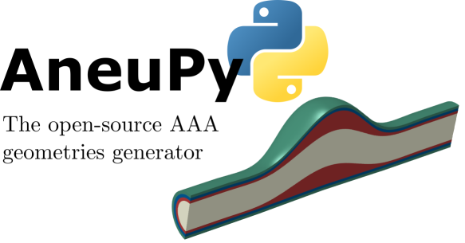

Pleased to announce the release of AneuPy v1.1.0, the new version of our open-source Python tool for generating simulation-ready geometries of abdominal aortic aneurysms (AAAs) with the SALOME platform.

This release reorganizes the code into a reusable Python package and adds several new features:

- **Image-derived parametric models**: AneuPy now reconstructs a model from a centerline and lumen and wall area profiles measured from medical images (for example with 3D Slicer and VMTK), with smoothing of both the centerline and the radius profiles.
- **Idealized models from dimensionless descriptors**: healthy, fusiform and saccular geometries with a multilayer wall (intima, media and adventitia) and an optional intraluminal thrombus.
- **Automatic geometry checks**: AneuPy stops or warns before producing an invalid solid, for example with tight bends, folded or crossing sections, or a failed surface fit.
- **Command-line interface** with JSON configuration files, so parametric studies can be run without writing code.
- **Building blocks for custom pipelines**, such as lofted and layered solids, for user-defined geometries and parameter sweeps.
- **Export** to STEP, IGES, STL, VTK and BREP, ready for meshing in FEA, CFD and FSI workflows.
- **Automated tests** that run without SALOME, plus an updated README with figures and step-by-step examples.

Get the new version here:

- [GitHub repository](https://github.com/mdeluci/AneuPy)
- [Release v1.1.0](https://github.com/mdeluci/AneuPy/releases)
- [Preprint](https://arxiv.org/abs/2504.15285)

{: width="750" }
